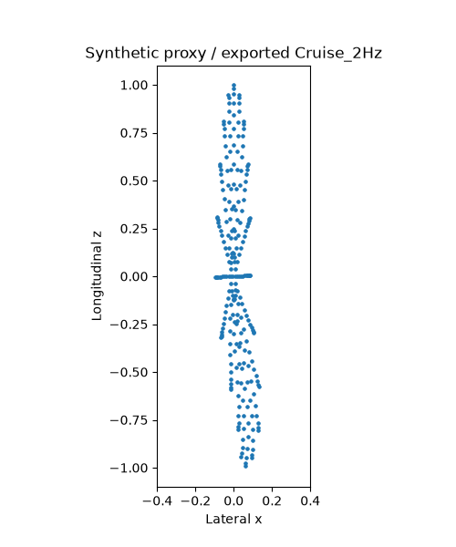

# FishSwim

FishSwim adds a procedural spine, linear-blend skin weights, and three looping animations to an unrigged GLB mesh using Python and NumPy. It writes glTF skins, joint attributes, inverse bind matrices, and quaternion animation channels while preserving the input file.

The swimming presets use authored kinematics. They have not been fitted to filmed fish and do not predict thrust, speed or energy use.

## Installation

Requires Python 3.10 or newer:

```sh
python3 -m venv .venv
source .venv/bin/activate
python -m pip install -e .
```

On Windows, activate with `.venv\Scripts\activate`.

## Run

```sh
fish-swim examples/synthetic-fish.glb animated.glb
fish-swim model.glb scaled.glb --target-length-m 0.60
fish-swim model.glb lower-amplitude.glb --amplitude-scale 0.75
fish-swim model.glb more-joints.glb --bones 19 --wave-onset 0.20 --envelope-exponent 2.2
```

The input must be a self-contained GLB with one unrigged mesh, one primitive, and the mesh in node 0. It must have its long axis along Z, snout toward +Z, tail toward -Z, and dorsal direction +Y. Sparse accessors and nonidentity mesh transforms are unsupported. Reorient or apply transforms before rigging. A generated test mesh is included at `examples/synthetic-fish.glb`. It is a simple shape for testing the rig, not a fish scan.

`--target-length-m` supplies a chosen scene scale; it does not measure the specimen. Without it, the original model units remain unchanged. The input and output must be different files. An existing output file can be replaced.

| Animation | Tailbeat frequency | One-sided target tail excursion / body length |
| --- | ---: | ---: |
| `Hold_1Hz` | 1 Hz | 0.025 |
| `Cruise_2Hz` | 2 Hz | 0.055 |
| `Burst_3Hz` | 3 Hz | 0.075 |

The centerline is a traveling sine wave with a posterior amplitude envelope. Neighboring centerline points determine bone headings; bone-length constraints and skinning mean actual mesh-tip excursions can differ from the targets. The default spine has 15 joints and keeps the head relatively still. Fins do not have independent articulation.

These presets are not measurements of Yellowstone cutthroat trout. Related background includes [trout kinematics in a vortex street](https://pmc.ncbi.nlm.nih.gov/articles/PMC6324577/) and [a kinematic model of Kármán gaiting](https://pmc.ncbi.nlm.nih.gov/articles/PMC3851150/); the preset values have not been fitted to those studies.



## Godot controller

Import the generated GLB into Godot 4 and attach `godot/FishSwimController.gd` to its scene or a parent `Node3D`. Set `initial_state` to `hold`, `cruise`, or `burst`, or call `set_swim_state("cruise")`. The controller finds the imported `AnimationPlayer` and enables looping. Movement and heading are controlled separately; clips do not translate the fish through the scene.

The same rigging approach is used by the Yellowstone project's brown and rainbow trout assets. This standalone repository contains the reusable generator and controller, without Yellowstone assets. The checks below do not establish Godot playback, specimen anatomy, or hydrodynamic accuracy.

## Optional preview

```sh
python -m pip install -e '.[preview]'
fish-swim-preview model.glb preview.mp4 --clip Cruise_2Hz --poster motion-sheet.jpg
```

Preview rendering also requires FFmpeg on `PATH`. It expects a textured mesh with UV coordinates and uses a fixed camera setup originally configured for a centered fish model. Different scales or offsets may need camera adjustment in `render_preview.py`. The renderer uses CPU skinning and VTK; a preview does not validate playback in another engine.

## Tests and limitations

```sh
python -m unittest discover -s tests -v
```

Synthetic tests check weight normalization, rest-pose recovery, stationary-head and moving-tail behavior, loop closure, inverse bind matrices, GLB serialization, and source-byte preservation. There is no empirical fish motion dataset in this repository. Mesh anatomy, texture continuity, watertightness, performance, and engine playback require separate evaluation.

## License

No reuse license is granted for this source code. Rights to user-supplied meshes and textures remain with their owners.
